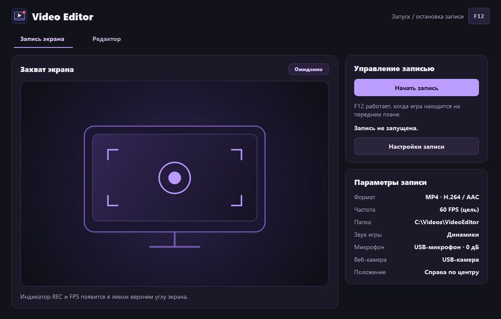
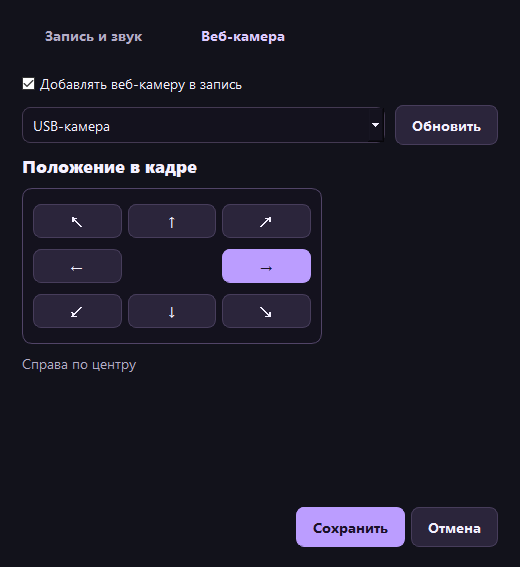
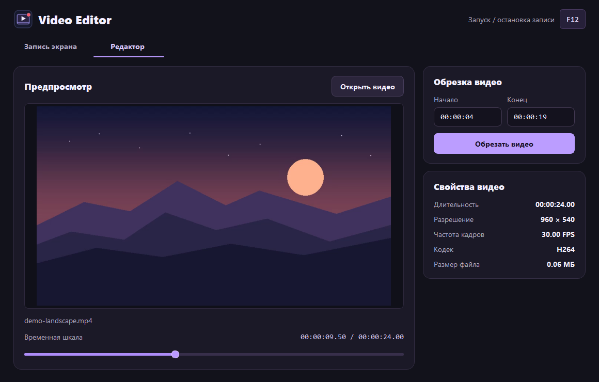

# Video Editor

Приложение для записи игрового экрана и обрезки видео. Запускайте запись клавишей **F12**, добавляйте звук игры, голос и изображение с веб-камеры, а затем обрезайте готовый MP4 во вкладке **Редактор**.



## Что умеет Video Editor

- **Запись экрана в Windows** по F12 или кнопке в приложении. Целевая частота записи — 60 кадров/с. Индикатор **REC** и фактический FPS записи появляются в левом верхнем углу экрана.
- **Звук игры и микрофона.** Для каждого источника можно выбрать устройство или отключить его. В настройках есть проверка микрофона с индикатором уровня и регулировка усиления.
- **Веб-камера в записи.** Вставку можно разместить в одном из восьми положений: в углах или по центру любой стороны кадра.
- **MP4 для YouTube.** Видео кодируется в H.264, звук сохраняется в AAC. Папка сохранения настраивается.
- **Редактор видео.** Есть предпросмотр, временная шкала и свойства файла. Обрезка через FFmpeg использует копирование потоков, чтобы сохранить исходное качество.

## Установка и запуск

### Windows

Для записи экрана нужна Windows и сборка FFmpeg с `ddagrab`, `dshow` и `libx264`. Приложение проверялось с Python 3.12. Для просмотра свойств видео также нужен `ffprobe`, который входит в полную сборку FFmpeg.

1. Установите [Python](https://www.python.org/downloads/) и [FFmpeg](https://ffmpeg.org/download.html). FFmpeg также можно установить командой `winget install --id Gyan.FFmpeg -e`.
2. Скачайте проект и откройте его папку в PowerShell.
3. Создайте виртуальное окружение и установите зависимости.

```powershell
python -m venv .venv
.\.venv\Scripts\python.exe -m pip install -r requirements.txt
```

4. Запустите приложение.

```powershell
.\run.bat
```

Для ярлыка на рабочем столе укажите `.venv\Scripts\pythonw.exe` в качестве программы, полный путь к `main.py` в качестве аргумента и папку проекта в качестве рабочей папки. Иконка находится в файле `video-editor.ico`.

На Linux и macOS доступна вкладка **Редактор**. Установите FFmpeg и зависимости из `requirements.txt`, затем запустите `python main.py`.

## Запись игры

1. Откройте **Запись экрана → Настройки записи**. Укажите папку и выберите источники звука. По умолчанию файлы сохраняются в **Видео → VideoEditor**, а аудио берётся с устройств воспроизведения и ввода Windows.
2. При необходимости проверьте уровень микрофона и включите веб-камеру. Настройки сохраняются между запусками. Камера по умолчанию выключена.
3. Переключитесь в игру и нажмите **F12**. Для отображения индикатора поверх игры используйте оконный режим без рамки.
4. Снова нажмите **F12** и дождитесь сохранения. Полный путь к MP4 появится на вкладке **Запись экрана**.

Захватывается первый экран DXGI. Звук игры берётся с выбранных динамиков или наушников вместе с другими звуками, которые воспроизводятся на этом устройстве. Если выбраны оба аудиоисточника, они сводятся в одну стереодорожку. При недоступной веб-камере приложение продолжит запись экрана и покажет предупреждение.

| Запись и звук | Веб-камера и положение в кадре |
| --- | --- |
|  |  |

## Обрезка видео

1. Перейдите на вкладку **Редактор** и нажмите **Открыть видео**.
2. Укажите начало и конец фрагмента. Предпросмотр позволяет проверить кадр на временной шкале.
3. Нажмите **Обрезать видео**. Готовый файл с префиксом `trimmed_` появится рядом с исходным.

При копировании потоков точка начала обрезки зависит от расположения ключевых кадров.



## Структура проекта

| Файл | Назначение |
| --- | --- |
| `main.py`, `editor_ui.py` | Окно, вкладки и оформление |
| `screen_recorder.py` | Захват экрана, F12 и сохранение записи |
| `recording_audio.py`, `webcam_capture.py` | Аудиоустройства, микрофон и веб-камера |
| `recording_settings.py` | Хранение и редактирование параметров записи |
| `video_processor.py` | Свойства видео, предпросмотр и обрезка |

Дополнительные материалы: [установка и диагностика](INSTALL.md), [руководство по редактору](USER_GUIDE.md).
